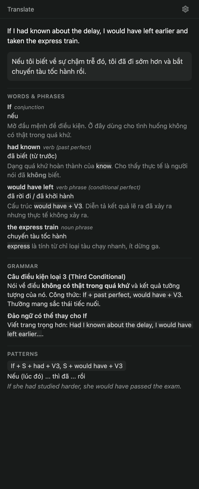

# Paseo Translate

A [Paseo](https://paseo.sh) plugin that turns selected text into a short English lesson. Select a
word, a phrase or a paragraph in a chat, click **Translate**, and the Explorer panel shows:

- the translation (Vietnamese by default),
- a word-by-word or phrase-by-phrase breakdown with part of speech and notes,
- the grammar at work, explained,
- reusable sentence patterns with examples.



`OVERVIEW.md` is the page Paseo shows when you browse plugins. This file covers installing, using and
developing it.

## Requirements

- Paseo daemon and app `0.11.2` or later.
- Plugins enabled on the daemon (`pluginsEnabled` in `config.json`, or **Settings → Plugins → Enable plugins**).
- Web app or desktop app. The native mobile app has no text selection hook, so the button never appears there.
- At least one chat in the workspace. The plugin reads the provider and model from it.

## Install

```bash
paseo plugin install github:nguyenvanduocit/paseo-translate
paseo plugin ls   # translate should be "running"
```

Paste `github:nguyenvanduocit/paseo-translate` into **Settings → Plugins → Plugin source** to install
from the app instead. Update with `paseo plugin update translate`.

## Use

1. Select text in a chat. The button appears when you release the mouse, or the key after a
   Shift+Arrow or Cmd/Ctrl+A selection.
2. Click **Translate**. The Explorer panel opens and shows the result when the lookup finishes.
3. The panel shows the latest result for the workspace; the next lookup replaces it. The gear opens the settings.

The result lives in memory and is gone after an app reload. A failed lookup shows its error and a Retry button.

## Settings

Open **Settings → Plugins → Translate**, or the gear in the panel. The values are stored on the
daemon, so every client of that daemon shares them.

| Setting | What it does |
| --- | --- |
| Translation prompt | The instruction sent to the helper agent. It names the target language. `{{text}}` is the selection and `{{sentence}}` is the text around it. Empty or unchanged means the built-in prompt. |
| Extra instructions | Appended to the end of every prompt, for example "medical context". |

The JSON reply format is appended after your prompt on every lookup, so a custom prompt cannot break
the result. To translate into another language, edit the language in the prompt.

## How it works

Each lookup creates a short-lived helper agent in the workspace you selected in. The helper uses the
provider and model of the workspace's most recent chat, receives the selection and up to 400
characters around it, and replies with JSON that the panel renders. Paseo archives the helper after
its first answer. See [docs/design.md](docs/design.md) for the decisions behind this.

## Known limits

- A lookup takes roughly 10 to 25 seconds, because each one is a full agent turn.
- Archived helpers stay in `~/.paseo/agents` and in the provider's session list. The plugin API has
  no delete call. `paseo ls -a -g --label paseo-translate=1` lists them and `paseo delete <id>` removes one.
- Helpers are told not to use tools. That is an instruction, not an enforced restriction.
- Selections over 5000 characters are ignored.
- The workspace id comes from the app's route (`/workspace/<id>`). A route change in Paseo breaks the
  button until `workspaceIdFromLocation` in `client/web.ts` is updated.

## Development

```bash
git clone https://github.com/nguyenvanduocit/paseo-translate.git
cd paseo-translate
npm install
npm run typecheck
npm test
paseo plugin install "$PWD"      # install from the working copy
paseo plugin reload translate    # after each source edit; never restart the daemon
paseo plugin logs translate
```

`npm test` runs the pure logic in `shared/` (selection rules, prompt building, reply parsing, inline
markup) with Node's test runner. The UI is checked by hand; the checklist is in
[docs/design.md](docs/design.md#testing).

| Path | Runs in | Contents |
| --- | --- | --- |
| `index.client.tsx` | App | Registers the panel, settings screen, Command Center item and selection listener. |
| `index.server.ts` | Daemon | Registers the settings document and the `translate.prompt` RPC. |
| `client/web.ts` | App (web only) | Selection listener and floating button. The only file that touches browser APIs. |
| `client/translator.ts` | App | Creates the helper agent and settles a lookup. |
| `client/TranslatePanel.tsx`, `client/ResultView.tsx`, `client/EmptyState.tsx` | App | The panel with its settings button, the result renderer, and the empty-state illustration. |
| `client/TranslateSettingsScreen.tsx` | App | Settings screen. |
| `client/lookups.ts` | App | In-memory store of the latest lookup per workspace. |
| `shared/translate.ts` | Both | Selection rules, prompt, reply schema and parser. |
| `shared/settings.ts`, `shared/rpc.ts`, `shared/rich-text.ts` | Both | Settings document, RPC contract, `**bold**` and `` `code` `` parser. |

Run this audit before a change that touches `client/`. A hit outside `client/web.ts` is a bug; the
three hits that are TypeScript generics such as `ReturnType<typeof …>` are not HTML.

```bash
rg -n "document\.|window\.|localStorage|navigator\.|<[a-z]+[ >]|className=|onClick=" client/
```

## License

[MIT](LICENSE)
